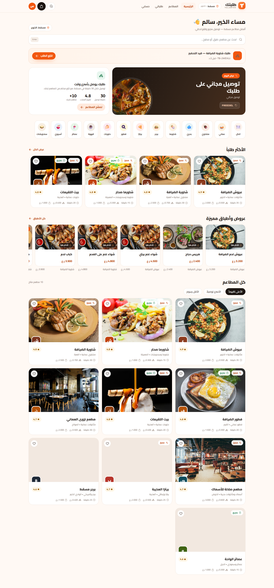
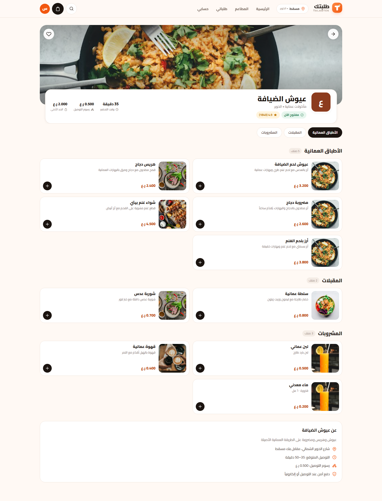
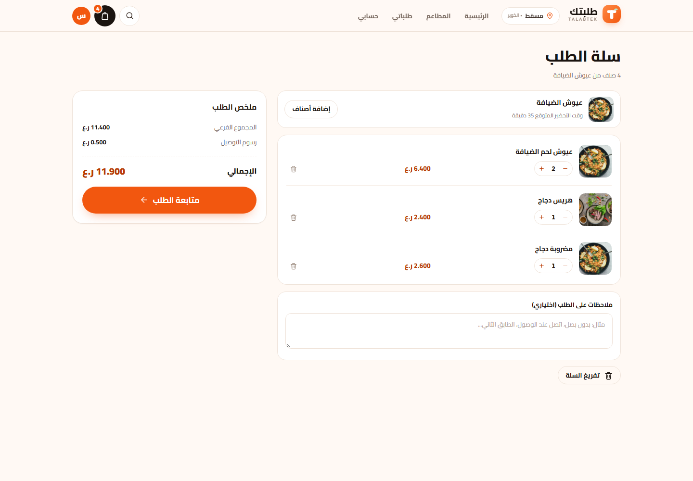
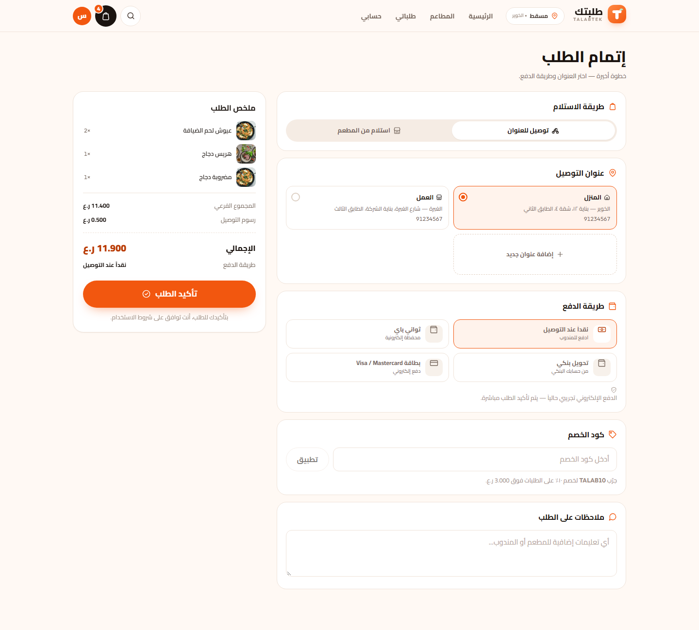
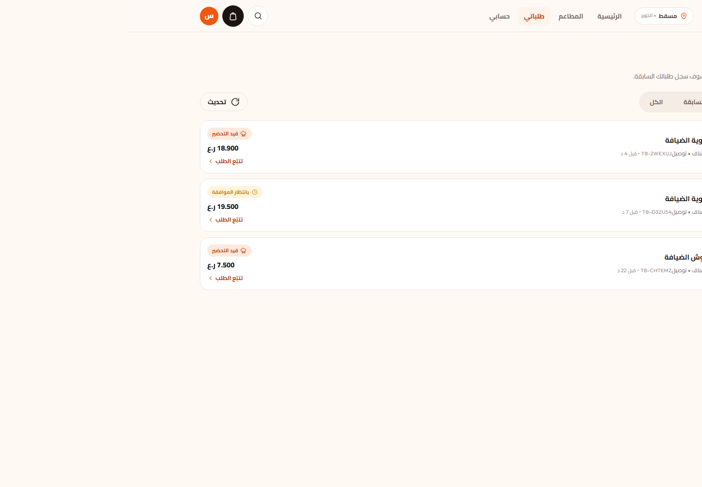
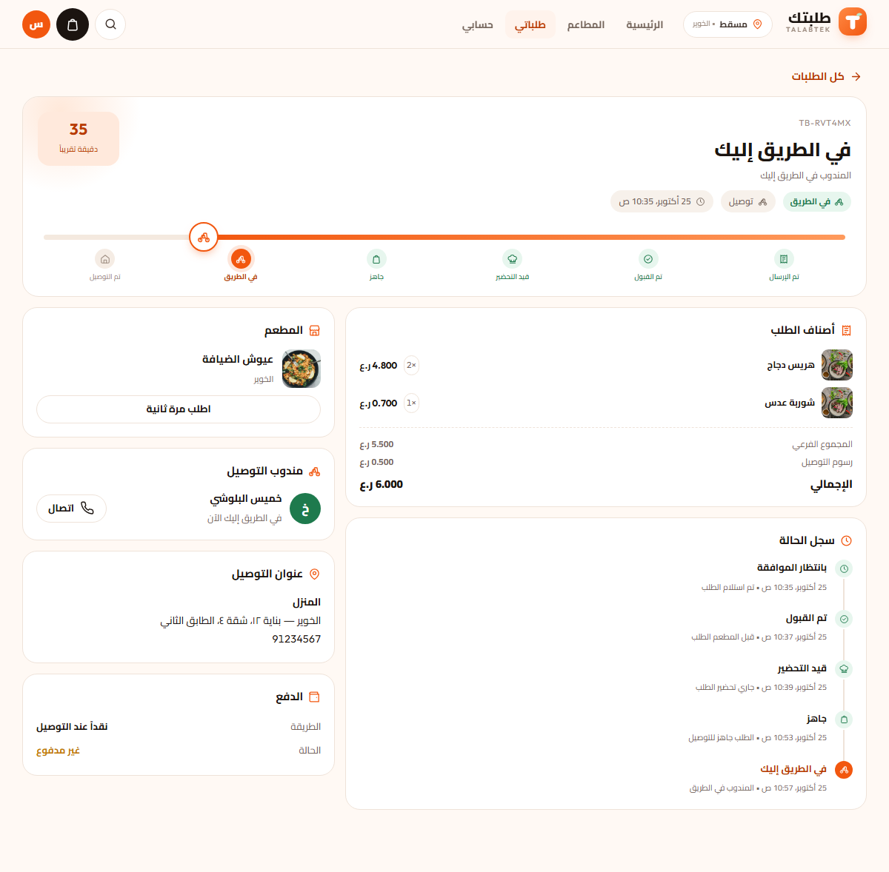

# طلبتك — تطبيق العميل

<p align="center">
  
</p>

<p align="center">
  <b>Talabtek Customer</b> — اطلب من مطاعم عُمان وتابع طلبك لحظة بلحظة<br/>
  أندرويد 6.0+ · الإصدار 1.0.0 · com.talabtek.customer
</p>

<p align="center">
  <a href="apk/talabtek-customer-1.0.0.apk"><b>⬇️ تحميل APK</b></a> ·
  <a href="https://github.com/ahmedhassan1948/talabtek-customer-android/releases/latest">أحدث إصدار</a>
</p>

---

## عن التطبيق

تطبيق العميل الرسمي لمنصة طلبتك: تصفّح مطاعم مسقط، أضف للأطباق للسلة، اختر العنوان وطريقة الدفع، وتابع حالة طلبك مباشرة حتى التسليم.

هذا التطبيق **غلاف WebView احترافي** لواجهة الويب الخاصة بـ [طلبتك](https://talabtek.com) — خفيف جداً (أقل من 0.1 ميجابايت)،
ويعمل دائماً بأحدث نسخة من الموقع بدون تحديث من المتجر.

## المزايا

- تصفح المطاعم والأقسام والأطباق الشائعة
- بحث فوري في المطاعم والأصناف
- سلة ذكية مع الخيارات والإضافات
- أكواد خصم وحد أدنى للطلب
- دفع نقداً أو بالبطاقة أو ثواني أو تحويل بنكي
- تتبع مباشر لحالة الطلب عبر SSE
- عناوين محفوظة ومفضلة
- واجهة عربية RTL وأسعار بالريال العماني (3 خانات)

## لقطات الشاشة








## التثبيت

1. حمّل ملف APK من [هنا](apk/talabtek-customer-1.0.0.apk) أو من صفحة الإصدارات.
2. فعّل «تثبيت من مصادر غير معروفة» لتطبيق المتصفح/الملفات.
3. افتح الملف وثبّت التطبيق.

> التطبيق موقّع بمفتاح تجريبي مرفق في `keystore/`. **قبل النشر على Google Play أنشئ مفتاحاً جديداً واحتفظ به سرّياً.**

## الحساب التجريبي

| الدور | الهاتف | كلمة المرور |
| --- | --- | --- |
| تطبيق العميل | `91234567` | `123456` |

التطبيق يفتح المسار `/app` مباشرة من الخادم.

## رابط الخادم

الرابط الافتراضي هو `https://talabtek.com`. لتجربة التطبيق على خادم محلي:

1. شغّل خادم طلبتك (المنفذ 4000).
2. افتح التطبيق بدون إنترنت أو أوقف الخادم مؤقتاً لتظهر شاشة «تعذّر الاتصال».
3. اضغط **«تغيير رابط الموقع»** وأدخل رابط الخادم، مثل:
   - محاكي أندرويد: `http://10.0.2.2:4000`
   - جهاز على نفس الشبكة: `http://192.168.1.20:4000`

## البناء من المصدر

المتطلبات: **JDK 17** و **Android SDK** (build-tools 34.0.0 + platform android-34). لا يحتاج Gradle.

```powershell
powershell -ExecutionPolicy Bypass -File build.ps1
```

الناتج: `releases/talabtek-customer-1.0.0.apk` موقّع وجاهز للتثبيت.

## بنية المشروع

```
AndroidManifest.xml      # الحزمة، الصلاحيات، النشاط الرئيسي
java/com/talabtek/customer/MainActivity.java
res/values/              # الاسم، الألوان، الثيم
res/drawable/            # شاشة البداية + أيقونة تكيّفية
res/mipmap-*/            # أيقونات mdpi → xxxhdpi
keystore/                # مفتاح التوقيع التجريبي (كلمة المرور: talabtek123)
apk/                     # ملف APK الجاهز
screenshots/             # لقطات من الواجهة
build.ps1                # بناء وتوقيع بدون Gradle
```

## الأيقونة

أيقونة التطبيق بتدرّج برتقالي ورمز **حقيبة تسوّق**، بأحجام mdpi (48) حتى xxxhdpi (192)
مع أيقونة تكيّفية (Adaptive Icon) لأندرويد 8+ وأيقونة متجر 512×512 في `store/icon-512.png`.

## الرخصة

© 2026 طلبتك — جميع الحقوق محفوظة. الاستخدام التجريبي مسموح مع الإشارة للمصدر.

